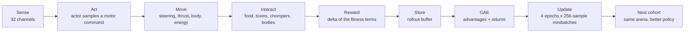

<div align="center">

# HELMINTH

**A PPO ecology for worms that forage, sense rivals, and flee chompers.**

A browser-native 2D artificial-life experiment: ten sensory worms share one Proximal
Policy Optimization actor-critic, learn to find nutrient blooms in a toxic arena, and
get hunted by ten small chompers. The policy is written from scratch on typed arrays —
no PyTorch, no TensorFlow, no ML dependency at all.

[](assess/visual-assessment.mjs)
[](LICENSE)
[](package.json)

<p align="center">
  
</p>

</div>

---

## Table of contents

- [Highlights](#highlights)
- [Screenshots](#screenshots)
- [Quick start](#quick-start)
- [How a cohort works](#how-a-cohort-works)
- [The policy](#the-policy)
- [The state space](#the-state-space)
- [The action space](#the-action-space)
- [The reward](#the-reward)
- [Does it actually learn?](#does-it-actually-learn)
- [Two bugs worth reading about](#two-bugs-worth-reading-about)
- [Can the worms see the wall?](#can-the-worms-see-the-wall)
- [Multi-agent notes](#multi-agent-notes)
- [The arena](#the-arena)
- [The sensorium](#the-sensorium)
- [Reward and fitness](#reward-and-fitness)
- [The chompers](#the-chompers)
- [Project layout](#project-layout)
- [Verification](#verification)
- [Notes and constraints](#notes-and-constraints)

---

## Highlights

- **PPO from scratch** — Gaussian actor, separate value critic, clipped surrogate
  objective, clipped value loss, entropy bonus, global gradient-norm clipping, and
  Adam, all implemented on `Float32Array`s with hand-written forward and backward
  passes. 2 861 parameters, ~110 ms for a full update.
- **Parallel on-policy rollouts** — all ten worms are sampled in lockstep, so one
  policy update consumes a full cohort of trajectories. A cohort ends only when the
  last worm in it is dead.
- **28-channel sensorium** — 8 food rays, 4 hazard rays, 4 wall rays, 4 rival-worm
  rays, 4 chomper rays, 2 self-body rays, energy, and bias, plus the worm's own speed,
  spin rate, and a 2-channel per-worm drift vector.
- **Body-aware worms** — 15-segment bodies, self-collision, worm-to-worm collision,
  wall response, and lethal energy loss.
- **Chomper patrol** — three predators that wander, chase, lunge, bite, digest, and
  retreat.
- **Non-blocking optimization** — the policy update is spread across frames on a 6 ms
  budget, so the arena never freezes while the weights are being rewritten.
- **Live neurotelemetry** — the actor graph with per-hop link colouring, hidden-layer
  activations, motor outputs, entropy, policy loss, fitness trace, and live ranking.
- **Evidence-based UI checks** — a Playwright assessment verifies the ecology, the
  24-sensor contract, the PPO update loop, responsive layout, and the absence of page
  errors: **22/22**.

---

## Screenshots

| | |
| --- | --- |
|  |  |
| **Standby** — the arena waits with ten worms, 120 blooms, six toxic pockets, and ten chompers. | **Cohort scored** — the toast reports the champion's score right after the policy update lands. |
|  |  |
| **Policy activity** — 26 inputs, two hidden layers of 24 units, two motors. Each layer transition gets its own colour and its own link budget. | **Fitness trace** — cohort best (solid) against cohort mean (dashed). The saw-tooth is cohort noise around a rising trend. |

| | |
| --- | --- |
|  |  |
| **The arena** — nutrient blooms, toxic pockets, and chompers sharing one 1360×1240 field. | **Leaderboard** — live ranking by cohort-cumulative fitness, with nutrients, distance, straightness, and lifespan. |


**After eight cohorts** the policy has learned to hold a heading instead of curling into
its own tail, and the cohort score has climbed from ~2 600 to ~3 500.

---

## Quick start

### Requirements

- Node.js `^20.19.0` or `>=22.12.0`
- A WebGL-capable browser (Chrome, Edge, Firefox, Safari)

### Run locally

```bash
npm install
npm run dev -- --port 4173 --strictPort
```

Open <http://127.0.0.1:4173/>, press **Start training**, and watch the policy learn.

On Windows, `START.bat` installs dependencies if needed, starts the server on port
4173, and opens the browser.

### Production build

```bash
npm run build        # bundle to dist/
npm run preview      # serve the bundle
```

### Run the visual assessment

```bash
npx playwright install chromium
npm run assess
```

The assessment builds the production bundle, serves it from a temporary static server
on an ephemeral port, drives it with headless Chromium, and writes screenshots plus
`report.json` to `assess/output/` (gitignored). The curated images in this README
live in `docs/screenshots/`.

### Controls

| Control | Effect |
| --- | --- |
| **Start / Pause training** | Runs or freezes the simulation. The policy update keeps working while paused only if it was already in flight. |
| **1× / 4× / 8×** | Simulation rate. The policy update is unaffected — the arena just advances faster between updates. |
| **PREDATORS** | The number of chompers in the arena, 0–24. Typing a number or using the stepper rebuilds the patrol in place: the new chompers are placed immediately and the spawn points are moved clear of them. The setting survives a reset. |
| **Reset** | Rebuilds the trainer from the configured seed: a fresh policy, a fresh arena, an empty fitness trace. |

---

## How a cohort works



1. **Sense.** Each living worm samples the 28-channel sensorium and appends its own
   drift vector.
2. **Act.** The shared actor emits a Gaussian mean; the policy samples a
   two-dimensional motor command (`turn`, `thrust`).
3. **Move.** Steering, thrust, speed, body joints, wall contact, and energy drain
   update at a fixed 60 Hz simulation step.
4. **Interact.** Food is consumed, toxic blooms damage worms, worm bodies collide,
   chompers bite, and a wall hit slides the worm along the boundary instead of
   pinning it.
5. **Reward.** The step reward is the exact delta of the fitness terms below, so the
   credit a worm receives is the credit the scorecard shows.
6. **Store.** Every transition lands in the rollout buffer. A worm that dies ends its
   own trajectory (bootstrapping with zero).
7. **Learn.** When the rollout fills (256 steps), GAE turns the buffer into advantages
   and four epochs of clipped minibatches rewrite the actor and the critic.

**A cohort ends when the last worm in it is dead.** There is no timer: a single
survivor keeps the cohort alive, so a cohort score always means "this wave was
wiped out", never "we stopped watching while they were still swimming". The next
cohort spawns into the same arena with the improved policy, and the arena never
freezes during an update — the optimization is spread across frames on a millisecond
budget while the worms keep swimming.

The consequence is visible in the data: an untrained policy loses its wave in about
30 seconds, while a trained one holds on for two minutes.

---

## The policy

| | |
| --- | --- |
| Actor | `32 → 24 → 24 → 2`, tanh hidden layers, linear output |
| Critic | `32 → 24 → 24 → 1`, a **separate** network so a bad value estimate can never poison the policy gradient |
| Parameters | 1 442 actor + 1 417 critic + 2 log-std = **2 861** |
| Action distribution | Diagonal Gaussian with a state-independent log-std |
| Motor mapping | `turn = tanh(1.8·u₀)`, `thrust = σ(2.2·u₁)` |
| Observation | 28 sensors + speed, spin, and a 2-channel drift vector = **32 channels** |

The next three sections are the full specification: the observation the policy
receives, the action it emits, and the reward it is trained on.

**The drift channels matter.** A single policy driving ten worms makes the cohort
behave like one body: identical headings, mutual collisions, and a lot of
self-inflicted curling. A per-worm random unit vector — re-rolled every cohort — is
appended to the observation, which gives each worm a distinct trajectory from the
first frame.

**Why the action mean gradient is a score function.** The motor command is a *fixed
sample* `u` of the Gaussian, so

```
∂ log π(u) / ∂ μ = (u − μ) / σ²
```

This is not a pathwise gradient. Getting its sign wrong makes the policy walk away
from good actions; see [Two bugs worth reading about](#two-bugs-worth-reading-about).

---

## The state space

### The physical state

A worm's true state is

$$
x_{phys} = \big(\underbrace{x, y}_{\text{position}},\ \underbrace{\theta}_{\text{heading}},\ \underbrace{v}_{\text{speed}},\ \underbrace{\omega}_{\text{turn rate}},\ \underbrace{\sigma}_{\text{steering}},\ \underbrace{\tau}_{\text{throttle}},\ \underbrace{E}_{\text{energy}},\ \underbrace{t}_{\text{age}}\big),
$$

together with the arena, which is static for the whole run: the bloom set
$\mathcal{B}$, the toxic pockets $\mathcal{P} = \{(c_j, r_j)\}$, the chomper set
$\mathcal{C}$, and the spawn points.

### The observation

The policy never sees $x_{phys}$ directly. It sees a fixed 32-channel projection
$o = g(x_{phys}) \in \mathbb{R}^{32}$, rebuilt every simulation step:

$$
o = \Big[\underbrace{o_{food} \in \mathbb{R}^{8}}_{\text{food rays}},\ \underbrace{o_{haz} \in \mathbb{R}^{4}}_{\text{hazard rays}},\ \underbrace{o_{wall} \in \mathbb{R}^{4}}_{\text{wall rays}},\ \underbrace{o_{riv} \in \mathbb{R}^{4}}_{\text{rival rays}},\ \underbrace{o_{chm} \in \mathbb{R}^{4}}_{\text{chomper rays}},\ \underbrace{o_{self} \in \mathbb{R}^{2}}_{\text{fold, side}},\ \underbrace{E/E_{max}}_{\text{energy}},\ \underbrace{1}_{\text{bias}},\ \underbrace{v/v_{max}}_{\text{speed}},\ \underbrace{\omega/\omega_{max}}_{\text{spin}},\ \underbrace{(\cos\phi, \sin\phi)}_{\text{drift}}\Big]
$$

**Ray geometry.** Every directional channel is a cone around the worm's own
heading. With $\hat{d}_k(\theta) = (\cos(\theta + \psi_k), \sin(\theta + \psi_k))$:

- food uses eight rays, $\psi_k = k\pi/4$, $k = 0 \dots 7$;
- every other directional channel uses four, $\psi_k \in \{0, \pi/2, \pi, -\pi/2\}$.

For a feature at $z$ with unit bearing $\hat{u}_z = (z - p)/\|z - p\|$, the
**alignment** of that feature on ray $k$ is the cosine $a_k = \hat{u}_z \cdot \hat{d}_k(\theta)$.

**Food** (8 rays, range $R_f = 330$) — for every *active* bloom $b$:

$$
o_{food,k} = \min\Big(1,\ \sum_{b \in \mathcal{B}} \mathbb{1}\!\left[\alpha_k^{(b)} > 0.04\right] \big(\alpha_k^{(b)}\big)^{3} \Big(1 - \tfrac{\|b - p\|}{R_f}\Big)^{1.7}\Big)
$$

**Hazard** (4 rays, range $R_h = 260$) — for every pocket $j$ with centre $c_j$ and
radius $r_j$, let $e_j = \|c_j - p\| - r_j$ be the edge distance and
$q_j = \min(1, \max(0, 1 - e_j/R_h))$:

$$
o_{haz,k} = \sum_{j \in \mathcal{P}} g_k^{(j)} q_j^{2},
\qquad
g_k^{(j)} = \begin{cases} 0.78 + 0.22\max(0, \alpha_k^{(j)}) & e_j \le 0 \\[2pt] \max(0, \alpha_k^{(j)})^{2} & e_j > 0 \end{cases}
$$

This is the one channel that is **not** clamped: it is an unclamped sum over
overlapping pockets, so it can exceed 1. (Food, rival and chomper channels are
each clamped to $[0, 1]$.)

**Wall** (4 rays, range $R_w = 210$) — $d_k$ is the distance from the head to the
inner arena boundary $[M, W-M] \times [M, H-M]$ (with $M = 26$) along the ray:

$$
o_{wall,k} = \min\Big(1, \max\big(0, 1 - \tfrac{d_k}{R_w}\big)\Big)
$$

**Rival worm** (4 rays, range $R_r = 300$) — for every other living worm, $c_w$ is
the closest point on its 15-segment body *polyline*, not its head:

$$
o_{riv,k} = \min\Big(1,\ \sum_{w \ne \text{self}} \mathbb{1}\!\left[\alpha_k^{(w)} > 0.04\right] \big(\alpha_k^{(w)}\big)^{3} \Big(1 - \tfrac{\|c_w - p\|}{R_r}\Big)^{1.5}\Big)
$$

**Chomper** (4 rays, range $R_c = 300$) — with $e_c = \|c - p\| - r_c$,
$q_c = \min(1, \max(0, 1 - e_c/R_c))$, and a salience that rewards an excited or
mid-chomp predator:

$$
o_{chm,k} = \min\Big(1,\ \sum_{c \in \mathcal{C}} \mathbb{1}\!\left[\alpha_k^{(c)} > 0.02\right] \big(\alpha_k^{(c)}\big)^{4} \Big(1 - \tfrac{e_c}{R_c}\Big)^{1.55} \cdot \big(1 + 0.32\,\text{excitement}_c + 0.38\,\mathbb{1}_{\text{chomping}}\big)\Big)
$$

**Self body** (2 channels) — over the body segments $k = 5 \dots 13$ (the first
five are the collision guard), with $d_k$ the head-to-segment distance and
$\ell_k = k \cdot \text{spacing}$ the natural arc length:

$$
o_{fold} = \max_{k \ge 5} \min\Big(1, \max\big(0, \tfrac{\ell_k - d_k}{\ell_k}\big)\Big),
\qquad
o_{side} = \frac{\hat{n}_{\perp} \cdot (c^* - p)}{\|c^* - p\|} \, o_{fold}
$$

where $c^*$ is the closest fold point and $\hat{n}_{\perp} = (-\sin\theta, \cos\theta)$
is the body-frame left normal — so $o_{side} > 0$ means the folded body lies on the
worm's left.

**The rest.** $E/E_{max} \in [0,1]$, a constant bias $1$, $v/v_{max} \in [0,1]$,
$\omega/\omega_{max} \in [-1,1]$, and a per-worm drift vector
$(\cos\phi, \sin\phi)$ with $\phi$ re-rolled each cohort.

**Everything spatial is heading-relative.** The absolute heading is deliberately
*not* observed: the arena is a fixed seed, so a world-frame reference would let the
policy memorise the bloom layout instead of learning to forage. The drift vector is
constant for the worm's whole life, so it acts as a per-worm bias — it breaks the
symmetry of ten clones sharing one policy without handing them a shared map.

**The observation is Markov with respect to the control-relevant dynamics** —
the speed and spin channels are what make that true.

---

## The action space

### The actor

The actor is a 32 → 24 → 24 → 2 tanh network with a linear output head:

$$
h_1 = \tanh(W_1 o + b_1), \qquad h_2 = \tanh(W_2 h_1 + b_2), \qquad \mu = W_p h_2 + b_p
$$

The action is a **sample** from a diagonal Gaussian with a state-independent
log-std $\rho \in \mathbb{R}^2$ (two extra learned parameters):

$$
u \sim \mathcal{N}\big(\mu, \mathrm{diag}(\sigma_a^2)\big), \qquad \sigma_a = e^{\rho} \in [0.074, 1.49]
$$

Each worm draws its own $\varepsilon$ from its own RNG stream, so identical weights
do not mean identical trajectories. The motor command is the squashed sample:

$$
\text{turn} = \tanh(1.8\, u_0) \in (-1, 1),
\qquad
\text{thrust} = \sigma(2.2\, u_1) \in (0, 1)
$$

**Log-probability.** PPO scores the *pre-squash* sample $u$, not the motor command.
Because $\tanh$ and $\sigma$ are bijections, the Jacobian cancels in the importance
ratio, so the surrogate below is exact for the squashed policy:

$$
\log \pi_\theta(u \mid o) = \sum_{k=0}^{1} \left[-\tfrac{1}{2} z_k^{2} - \log \sigma_k - \tfrac{1}{2}\log 2\pi \right],
\qquad z_k = \frac{u_k - \mu_k}{\sigma_k}
$$

**The score function** (the gradient the whole learner rests on):

$$
\nabla_{\mu} \log \pi = \frac{u - \mu}{\sigma_a^{2}},
\qquad
\nabla_{\rho} \log \pi = z^{2} - 1
$$

### The plant

The action is a *target*, not the applied torque or speed. Both channels pass
through a first-order lag, and the turn rate and speed follow from them:

$$
\sigma \leftarrow \sigma + (\text{turn} - \sigma)\big(1 - e^{-7.5 \Delta t}\big),
\qquad
\tau \leftarrow \tau + (\text{thrust} - \tau)\big(1 - e^{-4.5 \Delta t}\big)
$$

$$
\omega = 2.65\,\sigma,
\qquad
\theta \leftarrow \theta + \omega\,\Delta t,
\qquad
v \leftarrow v + \big(\text{vigor} \cdot v^{\star} - v\big)\big(1 - e^{-5 \Delta t}\big)
$$

$$
\text{vigor} = 0.62 + 0.38\,\frac{E}{E_{max}},
\qquad
v^{\star} = 32 + 138\,\tau
$$

$$
p \leftarrow p + v\,(\cos\theta, \sin\theta)\,\Delta t
$$

**Wall response.** A worm that would leave the arena is clamped to
$[M, W-M] \times [M, H-M]$. Rather than stopping dead, the head *slides* along the
boundary: with $\Delta p$ the clamped displacement, $\theta_{slide} = \mathrm{arg}(\Delta p)$
and $\theta_{inward} = \mathrm{arg}(\text{centre} - p)$:

$$
v \leftarrow 0.55\,v, \qquad \tau \leftarrow 0.7\,\tau, \qquad
\theta \leftarrow \theta_{slide} + \min\big(0.35, \max(-0.35, \mathrm{wrap}(\theta_{inward} - \theta_{slide}))\big) \cdot 0.55
$$

so the body stays in a line behind the head instead of piling into it.

---

## The reward

### The fitness

$$
F = \max\Big(0,\ 180\,N_{food} + 6\,t + 0.018\,L_{straight} + 0.045\,D_{forward} + 0.35\,E - 3.5\,T_{hazard} - 2.4\,\Theta_{turn}\Big)
$$

with $N_{food}$ the blooms eaten, $t$ the age, $L_{straight}$ the path length
weighted by directional consistency, $D_{forward}$ the net displacement from the
spawn point, $T_{hazard}$ the seconds spent inside a toxic pocket, and
$\Theta_{turn}$ the accumulated absolute rotation.

### The step reward

The reward the learner actually sees is the **delta of the fitness terms**, so the
credit a worm receives is the credit the scorecard shows:
$$
r_t = \underbrace{6\,\Delta t}_{\text{survive}} + \underbrace{180\,\Delta N_{food}}_{\text{forage}} + \underbrace{0.018\,\Delta L_{straight}}_{\text{straight travel}} + \underbrace{0.045\,\Delta D_{forward}}_{\text{net progress}} + \underbrace{0.35\,\Delta E}_{\text{energy}} - \underbrace{3.5\,\Delta T_{hazard}}_{\text{toxic exposure}} - \underbrace{2.4\,\Delta\Theta_{turn}}_{\text{turning cost}} - \underbrace{25\,\mathbb{1}_{\text{died}}}_{\text{death}}
$$

The energy term is measured against the last *accounted* energy, so damage dealt
between steps — a chomper bite, for instance — lands in the next step's reward
rather than vanishing.

### The energy dynamics it reacts to

$$
E_{t+1} = \min\big(E_{max},\, E_t + 24\,\mathbb{1}_{\text{ate}}\big) - 27\,I_{haz}(p_t)\,\Delta t - \big(1.15 + 0.0045\,v_t\big)\Delta t - 18\,\mathbb{1}_{\text{bite}}
$$

with the energy clamped at zero on death, and

$$
I_{haz}(p) = \max_{j \in \mathcal{P}} \begin{cases} 1 - 0.32\,\frac{\|p - c_j\|}{r_j} & \|p - c_j\| < r_j \\[2pt] 0 & \text{otherwise} \end{cases}
$$

The chomper bite lands between steps, which is why the reward's energy term is
measured against the last *accounted* energy rather than the previous step's.

### The learning objective

With $\gamma = 0.99$ and $\lambda = 0.95$, the generalised advantage estimate over the observation $o_t$ is

$$
\delta_t = r_t + \gamma\,V(o_{t+1})\,\mathbb{1}_{\neg \text{terminal}} - V(o_t),
\qquad
A_t = \delta_t + \gamma\lambda\,\mathbb{1}_{\neg \text{terminal}}\,A_{t+1},
\qquad
\hat{R}_t = A_t + V(o_t)
$$

and the PPO update minimises

$$
\mathcal{L} = \mathcal{L}_{policy} + c_v\,\mathcal{L}_{value} - c_e\,\mathcal{L}_{entropy}
$$

$$
\mathcal{L}_{policy} = -\,\mathbb{E}\Big[\min\big(\varrho A,\ \mathrm{clip}(\varrho, 1-\epsilon, 1+\epsilon)\,A\big)\Big],
\qquad \varrho = \frac{\pi_\theta(u \mid o)}{\pi_{\theta_{old}}(u \mid o)}
$$

$$
\mathcal{L}_{value} = \mathbb{E}\Big[\tfrac{1}{2}\max\big((V - \hat{R})^2,\ (V_{clip} - \hat{R})^2\big)\Big],
\qquad V_{clip} = V_{old} + \mathrm{clip}(V - V_{old}, -\epsilon_v, \epsilon_v)
$$

$$
\mathcal{L}_{entropy} = \mathbb{E}\left[\sum_{k=0}^{1} \left(\rho_k + \tfrac{1}{2}\log 2\pi e\right)\right]
$$

The clipped branch has **zero** gradient once $\varrho$ leaves
$[1-\epsilon, 1+\epsilon]$ — the clamp is flat there — and the whole loss is
minimised by Adam over the 2 861 parameters with the global gradient norm clipped
at 0.5.

| Hyper-parameter | Value | Why |
| --- | --- | --- |
| Discount $\gamma$ | 0.99 | ≈ 1.7 s of lookahead |
| GAE $\lambda$ | 0.95 | Low-variance advantage estimates |
| Clip ratio $\epsilon$ | 0.2 | The trust region that makes PPO stable |
| Value clip $\epsilon_v$ | 0.2 | The same trust region on the critic |
| Value coefficient $c_v$ | 0.5 | The critic never dominates the shared gradient norm |
| Entropy coefficient $c_e$ | 0.01 | Keeps the action distribution from collapsing |
| Learning rate | 3 × 10⁻⁴ | Adam, with global gradient clipping at 0.5 |
| Epochs × minibatch | 4 × 256 | Four passes over each 2 560-sample rollout |
| Rollout length | 256 steps | ≈ 4.3 s of arena time |
| Initial log-σ | −0.7 | σ ≈ 0.50 at the start of a run |

**Returns are rescaled.** The arena pays 180 for a nutrient bloom, so raw discounted
returns span several orders of magnitude. A running estimate of the return spread
divides the rewards before the critic sees them, otherwise the value loss dominates
the shared gradient norm and the policy gradient is clipped away. The measured value
loss drops from ~700 to ~0.3 with the rescaling in place.

**The update is incremental.** `processBatch` is called a few minibatches at a time
under a 6 ms per-frame budget, so a 40-minibatch update spreads over ~20 frames
instead of blocking the render loop for 110 ms.

---

## Does it actually learn?

Measured over four runs of 400 000 steps (the median is quoted; the spread across
seeds is large because a cohort is scored only once it has been wiped out):

| Metric | First third of the run | Last third | Change |
| --- | ---: | ---: | ---: |
| Mean cohort fitness | 900 | 4 650 | **+417%** |
| Mean cohort length (seconds alive) | 32 s | 128 s | **+300%** |
| Best single cohort | — | 149 837 | — |
| Longest single cohort | — | 976 s | — |

The second row is the one that matters most: a cohort is only scored once it has
been *wiped out*, so the score measures how long the policy kept its worms alive
against ten chompers. By the end of a run a trained policy can hold one worm
alive for **sixteen minutes** in an arena where an untrained one survives half a
minute.

Every seed improves — the per-seed gains run from +207 % to +436 % — but the
variance between runs is large, and it is not noise in the seed: the update is
spread across frames against a live simulation, so the exact interleaving of
policy updates and worm steps depends on wall-clock timing. The arena, the policy
initialisation, and the cohort layout are all seeded and reproducible; the
*trajectory* is not bit-for-bit.

The same build, before the policy gradient was corrected, *degraded* instead of
improving — the policy learned to stop foraging and die within seconds. That failure
is what the gradient check below was written for.

Reproduce it yourself (exact numbers drift a little with the RNG stream, the trend does not):

```bash
node -e "
import('./src/ppo/trainer.js').then(async ({Trainer}) => {
  const {CONFIG} = await import('./src/config.js');
  const t = new Trainer(CONFIG); t.start();
  const mean = (rows) => rows.reduce((s, r) => s + r.average, 0) / rows.length;
  for (let i = 0; i < 400000; i++) {
    t.step(1/60);
    if (t.phase === 'intermission') t.nextCohort();
    if (i % 600 === 0) t.continueUpdate(100);
  }
  const h = t.history;
  console.log('first6', mean(h.slice(0,6)).toFixed(0), 'last6', mean(h.slice(-6)).toFixed(0));
});
"
```

---

## Two bugs worth reading about

A policy-gradient implementation is easy to get subtly wrong, and both of these bugs
looked like "the agent is just bad at this task". Both were found by comparing the
analytic gradient against a finite-difference estimate of the same loss.

**1. The action-mean gradient had the wrong sign.** The update used `−(u − μ)/σ²`
instead of `+(u − μ)/σ²`, so every positive-advantage action pushed the mean *away*
from the sample that earned the reward. The policy reliably walked into hazards and
stopped foraging; by cohort 80 the arena was empty and every worm died within a
second. The fitness trace declined monotonically.

**2. The clipped branch kept a phantom gradient.** When the importance ratio leaves
`[1−ε, 1+ε]`, the clamp is flat, so `∂ clip(r)/∂r = 0` and the surrogate contributes
nothing. The implementation instead used `−clip(r)·A`, which is a non-zero push from
exactly the samples that should have been ignored.

After the fixes, the check agrees with finite differences to **2.7 × 10⁻⁶** (the
float32 storage precision is the floor):

```
  actor.layer0[0] numeric=-2.6400e-4 analytic=-2.6413e-4 err=1.32e-7
  actor.layer1[0] numeric= 6.2355e-3 analytic= 6.2355e-3 err=5.00e-8
  actor.layer2[0] numeric= 4.1557e-2 analytic= 4.1557e-2 err=2.71e-8
  critic.layer2[0] numeric= 7.5885e-2 analytic= 7.5886e-2 err=1.29e-6
  logStd[0]      numeric= 3.6948e-2 analytic= 3.6948e-2 err=3.00e-7
  worst relative error 2.749e-6 — GRADIENT CHECK PASSED
```

---

## Multi-agent notes

**A shared policy with ten identical agents is a degenerate multi-agent problem.** The
first build inherited the HyperNEAT layout — ten worms, each with its own genome — and
replaced the genome with one shared policy. Every worm then faced the arena with the
same heading policy, so they converged on the arena centre, folded into their own
tails, and collided. Roughly 77 % of all deaths were body collisions.

Two changes fixed it:

1. **Per-worm action noise.** Each worm draws its motor command from its own RNG
   stream, so identical weights do not mean identical trajectories.
2. **A per-worm drift vector** in the observation, which breaks the symmetry
   *systematically* rather than stochastically.

A third change — replacing fallen worms mid-cohort — was tried and then removed: it
kept the arena populated, but it made extinction impossible, and with it the meaning
of a cohort score. A cohort is now a wave: it is scored when the last worm in it is
dead, and a single survivor keeps it running.

---

## The arena

A fixed 1360×1240 field, seeded identically every run, so a cohort's fitness is
comparable to the one before it:

- **120 nutrient blooms** with a 3.8 s respawn, spread across the field;
- **6 toxic pockets** (radius 58–104) that drain 27 energy per second and are placed
  clear of the spawns;
- **10 chompers** by default (0–24, set live from the panel) that patrol, chase, and bite;
- **10 worms** that start at evenly spaced positions — at least 150 units apart, clear
  of toxic pockets, and kept well away from chomper patrol routes.

Worms start with 58 energy, drain 1.15/s plus a speed term, and cap at 100. The
boundary is 26 units from the edge of the field; a worm that reaches it slides along
it and drifts back into the arena rather than stopping dead.

---

## The sensorium

The full channel-by-channel equations are in
[the state space section](#the-state-space). The layout at a glance:

| Channel | Inputs | Range | What it measures |
| --- | ---: | --- | --- |
| Food | 8 | 330 | Directional alignment and closeness to active nutrient blooms |
| Hazard | 4 | 260 | Toxic-pocket proximity, with a stronger signal inside the bloom |
| Wall | 4 | 210 | Distance to the arena boundary along the front, left, back and right rays |
| Rival worm | 4 | 300 | Direction and closeness to the nearest point on another worm's body |
| Chomper | 4 | 300 | Direction and closeness to a chomper, boosted by chase excitement and active chomping |
| Self body | 2 | — | How tightly the head is folded against its own trailing segments, and which side that body lies on |
| Energy | 1 | — | Current energy normalized to maximum |
| Bias | 1 | — | Constant `1` |
| Speed | 1 | 170 | Current speed over the maximum, so the policy can tell "closing on the wall at 170" from "drifting at 30" |
| Spin | 1 | 2.65 | Current angular velocity over the maximum turn rate, in `[-1, 1]` |
| Drift | 2 | — | A per-worm random unit vector, re-rolled each cohort |

Food uses eight rays around the heading. Hazard, wall, rival, and chomper channels
each use four rays. Rival sensing samples the nearest *body segment* rather than only
the other worm's head, so body contact is represented too. The two self channels let a
worm feel its own body: one reports how far the head has folded back onto its
trailing segments, the other reports which side that body lies on, so a coil can be
unwound before it becomes a lethal self-collision.

**Every spatial channel is heading-relative**, which is why the last four inputs
matter. The speed and spin channels are the only way the policy knows anything about
its own motion: without them, a worm coasting at 170 u/s and one drifting at 30 u/s
produce an identical wall reading, even though the first has to turn *now*. With
them the observation is Markov with respect to the control-relevant dynamics.

**There is deliberately no absolute heading.** The arena is a fixed seed, so a
world-frame reference would let the policy memorise the bloom layout and drive to it
instead of learning to forage — a much better score for a much worse policy. The
per-worm drift vector is a constant, so it acts as a per-worm bias rather than a
frame of reference, and it breaks the symmetry of ten clones sharing one policy
without handing any of them a shared world map.

---

## Reward and fitness

The scorecard formula and the step reward it produces are written out in
[the reward section](#the-reward). In short:

```text
fitness = max(0,
    foodEaten      × 180
  + age            × 6
  + straightTravel × 0.018
  + forwardProgress× 0.045
  + energy         × 0.35
  - hazardTime     × 3.5
  - radiansTurned  × 2.4
)
```

`forwardProgress` is the net displacement from the worm's spawn point, not total path
length, so looping in place does not earn the forward reward. `radiansTurned` is the
absolute accumulated steering rotation, so continuous circling carries a cost.
`straightTravel` is path length weighted by directional consistency: each step only
earns travel credit in proportion to how straight the worm has been moving, so a
straight sprint is worth far more per unit than a tight circle. Together these three
terms make circling unprofitable — a worm that loops in place earns neither travel
nor forward credit and pays for every radian it turns.

---

## Can the worms see the wall?

They could not, and the arena was quietly killing them for it.

The first build had no wall channel at all. A boundary was felt only *after* contact:
the head was clamped, the speed halved, and the heading snapped toward the arena
centre. Nothing in the observation said "the edge is over there", so the policy
learned to hug walls and then die there.

The tell was in the death census:

```
collision:        168 (45.4%)   rival worm bodies
self-collision:   117 (31.6%)   ← 115 of these within 40 units of a wall
predation:         47 (12.7%)
toxicosis:         29 (7.8%)
starvation:         9 (2.4%)
direct 'wall' deaths: 0
```

The wall never killed anything by itself. What happened is worse: a worm grazed the
boundary, the head was pinned against it, the trailing body kept advancing into the
pinned head, and the worm folded onto itself. **98 % of wall-adjacent self-collisions
happened within one second of a wall hit** — the wall was the trigger, not the
location.

Two changes fixed it:

1. **A wall channel.** Four heading-relative rays (front, left, back, right) report
   the distance to the boundary within 210 units, so the policy can see the edge
   before it touches it.
2. **A slide instead of a pin.** A wall hit now redirects the head along the boundary
   tangent, with a gentle drift back into the arena, instead of stopping it dead. The
   body stays in a line behind the head instead of piling into it.

The second change is the one that matters:

```
before:  self-collision deaths 117   total deaths 370
after:   self-collision deaths   3   total deaths 229
```

Self-collision deaths fell by 97 %, and cohorts that used to end after 30 seconds now
run for minutes — the longest measured cohort survived **263 seconds** before the
chompers finished it.

### Seeing the wall is not enough on its own

With the wall visible but the head still pinned, the channel was worth only ~10 %:
the policy could see the edge but not how fast it was closing on it. A worm coasting
at 170 u/s and one drifting at 30 u/s produced an *identical* wall reading, even
though the first has to turn immediately. The observation was missing the one
quantity needed to act on the perception.

Adding the worm's own **speed** and **spin rate** to the state closes that gap and
makes the observation Markov with respect to the control-relevant dynamics. Paired
across four seeds with an identical architecture and identical initial weights (the
two channels are simply zeroed in the control arm):

| | kinematics off | kinematics on |
| --- | ---: | ---: |
| Median last-6 cohort score | 4 680 | **4 866** |
| Median last-6 cohort length | 156 s | **198 s** |
| Wall-adjacent self-deaths | 31 | **23** |
| Wall-adjacent deaths per second of arena time | 0.0026 | **0.0018** |

A modest win rather than the unlock it looked like — because the slide fix had
already removed the trap that made the perception matter. What the channels buy is a
state that is actually sufficient: the policy can now work out its own closing speed
and whether it is already turning away.

---

## The chompers

There are **ten** of them by default — one per worm, which is what makes the arena
a hunt rather than a stroll — and the panel's `PREDATORS` input takes that anywhere
from 0 to 24. Changing it rebuilds the patrol in place: the new chompers are placed
immediately, the spawn points are moved clear of them, and the change survives a
reset. The behaviour of each one is deliberately simple and readable:

- cruise toward a wandering target when no worm is nearby;
- lock onto the nearest living worm within 270 units;
- accelerate into a lunge inside roughly 42 % of their sensing range;
- bite for 18 energy on contact, then digest and cool down;
- retreat briefly after a successful bite.

Their bodies, googly eyes, teeth, and `CHOMP!` bubbles are rendered in the Three.js
arena. Chompers have their own sensor channel rather than being folded into generic
hazard data.

---

## Project layout

```text
src/
  config.js            Simulation, fitness, predator, sensor, and PPO constants
  main.js              App loop, controls, debug hooks
  ppo/
    network.js         Dense/MLP primitives, Gaussian actor-critic, graph description
    rollout.js         Parallel rollout buffer, GAE, return statistics
    optim.js           Adam with global gradient-norm clipping
    ppo.js             Clipped surrogate, clipped value loss, entropy, minibatch updates
    trainer.js         Cohort lifecycle, rollout collection, update scheduling
  sim/
    worm.js            Sensors, policy actions, movement, energy, bites, step reward
    predators.js       Chomper pack, chase/lunge/chomp state machine
    ecology.js         Food, toxic blooms, hazard and spawn placement
    collisions.js      Worm body collisions and death resolution
    random.js          Seeded RNG and math helpers
  render/
    arena.js           Three.js arena, worm visuals, chomper visuals, effects
  ui/
    dashboard.js       Live telemetry, policy graph, fitness trace
index.html             App shell and copy
START.bat              Windows one-click launcher
assess/                Playwright visual and behavioral assessment
docs/screenshots/      Curated README images
```

---

## Verification

`npm run assess` currently passes **22/22** checks, including:

- WebGL arena geometry and visible motion;
- the chomper count matching the panel control, and the control rebuilding the patrol live;
- 28 sensors with food, hazard, wall, worm, chomper, and self-body channels;
- a PPO update running on the collected rollout, with finite telemetry;
- policy weights actually changing under the optimizer;
- cohort scoring and advancement to the next cohort;
- cohort termination on extinction — never on a timer with worms still alive;
- pause/resume behavior;
- rendered fitness trace;
- 1440×900 compact layout with no clipped panels or page overflow;
- no uncaught page errors.

The policy gradient is additionally verified against finite differences, and the
learner is verified end-to-end by the measured cohort curve above.

---

## Notes and constraints

- The arena is a fixed, seeded field, so a run is reproducible: the same seed
  produces the same blooms, pockets, chomper routes, and starting positions.
- Mortality is real and lethal — worm-to-worm and self-collisions both kill — and an
  untrained policy curls into its own tail quickly. Watching that mortality fall as
  the policy improves is the point.
- There is no backend and no persistence. Reset restarts the run from the configured
  seed.
- The simulation is tuned for desktop; the right-side telemetry panel is hidden below
  1040 px.
- The assessment screenshots are generated artifacts. The checked-in
  `docs/screenshots/` copies are the stable README images.

---

<div align="center">

**HELMINTH** — written as a study in replacing an evolutionary search loop with a
policy gradient, and in how easily the latter can be wrong.

</div>
